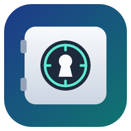

<div align="center">



# Cofre de Contas

**Gerenciador de senhas open source, local e offline para Windows**
<br>
*Open source, local-first password manager for Windows — your vault never leaves your PC.*

[](LICENSE)


[Funcionalidades](#funcionalidades) ·
[Como instalar](#como-instalar) ·
[Segurança](#segurança-e-limitações-conhecidas) ·
[Contribuir](#como-contribuir) ·
[English](#english-summary)

</div>

---

O **Cofre de Contas** é um cofre de senhas para desktop que guarda suas contas, credenciais,
notas e dados de autenticação em dois fatores **criptografados no seu próprio computador**.
Não há conta online, servidor, assinatura nem sincronização em nuvem: o arquivo do cofre fica na
sua máquina e só abre com a sua senha mestra.

Ele foi pensado para quem gerencia **muitas contas em muitas plataformas** (redes sociais,
e-mails, projetos de clientes) e quer organizá-las por projeto, plataforma e etiqueta — sem
entregar esses dados a um serviço de terceiros.

> **Estágio do projeto: beta, mantido por uma pessoa.** O código passou por revisões de
> segurança internas (registradas neste repositório), mas **não por uma auditoria independente**.
> Leia [Segurança e limitações conhecidas](#segurança-e-limitações-conhecidas) antes de confiar
> nele as suas senhas mais importantes, e mantenha backups.

## Como instalar

> **Baixou o projeto e só encontrou pastas com código?** Isso é o código-fonte, não o aplicativo:
> não há um `.exe` pronto para abrir nele. Escolha um dos caminhos abaixo.

| Você quer… | Faça isto |
|---|---|
| **Só usar o app** | Baixe o arquivo `…_x64-setup.exe` na página **[Releases](https://github.com/juniorrafaels/cofre-de-senhas/releases)**, instale e abra **Cofre de Contas** pelo menu Iniciar. *(Ainda não há versão publicada; enquanto isso, use a linha abaixo.)* |
| **Gerar o instalador a partir do código** | Instale Node.js, Rust e o compilador C++ da Microsoft (comandos no guia), extraia o ZIP e dê dois cliques em **`Compilar instalador.bat`**. No final, a pasta com o instalador abre sozinha |
| **Desenvolver / contribuir** | Siga [Compilar a partir do código-fonte](#compilar-a-partir-do-código-fonte-desenvolvedores) |

📘 **Passo a passo completo, primeiros passos (senha mestra, Recovery Key, backup), atualização e
desinstalação:** [docs/INSTALACAO.md](docs/INSTALACAO.md).

## Funcionalidades

**Cofre e criptografia**
- Senha mestra com derivação de chave **Argon2id** e criptografia autenticada **XChaCha20-Poly1305**.
- Senhas, notas, detalhes de 2FA e propriedades marcadas como sensíveis são cifrados individualmente.
- **Recovery Key** opcional (com kit de recuperação para imprimir) para recuperar o acesso.
- **Backup criptografado** (`.vaultbackup`) para exportar e importar o cofre inteiro. Restaurar
  sobre um cofre existente exige a senha mestra atual.
- *Perguntas de segurança (descontinuado):* cofres antigos que já as têm continuam podendo usá-las
  para recuperar o acesso, mas não é possível criar novas (ver [Segurança](#segurança-e-limitações-conhecidas)).

**Proteção durante o uso**
- Bloqueio automático por inatividade (tempo configurável).
- Bloqueio ao minimizar (opcional).
- Bloqueio quando o Windows é bloqueado (Win+L) ou entra em suspensão.
- Copiar senha sem exibi-la, com limpeza automática da área de transferência. No Windows, segredos
  copiados ficam fora do Histórico (Win+V) e da sincronização em nuvem.
- Limite de tentativas para revelar segredos e para a recuperação por perguntas legadas.

**Organização**
- Contas agrupadas por **projetos** e **plataformas** (19 plataformas pré-cadastradas, editáveis).
- **Etiquetas**, favoritos, arquivo e **lixeira** com restauração.
- **Propriedades personalizadas** por conta (ex.: "Chave de API"), sensíveis ou não.
- **Histórico** de alterações por conta e status da conta.
- **Gerador de senhas** configurável.
- Visualização em grade ou lista, colunas configuráveis, escala da interface e tema claro/escuro.
- Interface em **português (Brasil), inglês e espanhol**.

## Por que armazenamento local?

| | Cofre de Contas | Gerenciadores em nuvem (ex.: LastPass, 1Password, Bitwarden) |
|---|---|---|
| Onde ficam os dados | Somente no seu PC | Servidores do provedor (cifrados) + dispositivos |
| Conta online / assinatura | Não | Sim (planos gratuitos variam) |
| Sincronização entre dispositivos | **Não** (use backup manual) | Sim |
| Extensão de navegador / preenchimento automático | **Não** | Sim |
| Aplicativo móvel | **Não** | Sim |
| Compartilhamento em equipe | **Não** | Sim |
| Funciona sem internet | Sim | Parcialmente (cache local) |
| Código aberto | Sim | Bitwarden: sim · LastPass/1Password: não |
| Auditoria de segurança independente | **Ainda não** | Sim, publicadas pelos fornecedores |

O Cofre de Contas é uma **alternativa local** para quem prefere não usar um serviço em nuvem —
não um substituto completo desses produtos, e não tem relação, afiliação ou compatibilidade com
eles (não importa nem exporta cofres do LastPass, 1Password ou Bitwarden). Nomes e marcas
citados pertencem aos respectivos donos.

## Tecnologias

- [Tauri 2](https://tauri.app) (WebView2 no Windows) — app desktop leve
- **Rust** no backend: toda a criptografia, o banco e as regras de segurança ficam aqui
- **React 19 + TypeScript + Vite + Tailwind CSS** na interface
- **SQLite** (via `rusqlite`, embutido) como armazenamento local
- Criptografia: `argon2`, `chacha20poly1305`, `hkdf`, `sha2`, `zeroize` (RustCrypto)

## Segurança e limitações conhecidas

Resumo abaixo. O modelo de segurança completo está em [SECURITY.md](SECURITY.md).

**O que o Cofre protege:** quem obtém **só o arquivo do cofre** (ex.: cópia do disco, backup
vazado) não consegue ler senhas, notas, 2FA nem propriedades sensíveis sem a senha mestra — a
dificuldade depende da força da senha mestra.

**O que o Cofre não protege:**
- Um computador já comprometido (malware, keylogger, acesso administrativo enquanto o cofre está
  aberto). Nenhum gerenciador de senhas local resolve isso.
- **Metadados em texto claro:** nomes de contas, usuários, e-mails, URLs, status, plataformas,
  projetos (incluindo as notas de projeto), etiquetas, propriedades não sensíveis, o texto das
  perguntas de segurança, o histórico de alterações e as imagens/avatares ficam legíveis para quem
  tiver acesso ao arquivo do cofre. Apenas senhas, notas da conta, detalhes de 2FA e propriedades
  marcadas como sensíveis são cifrados.
- **Perguntas de segurança legadas são o elo mais fraco:** cada resposta pode ser testada
  isoladamente, offline, por quem obtiver o arquivo do cofre ou um backup. Por isso o recurso foi
  descontinuado. Se o seu cofre ainda tem perguntas, gere uma **Recovery Key** e exclua-as.
- Trocar a senha mestra não recriptografa os dados: um backup antigo mais a senha antiga dele
  continuam permitindo abrir os dados. Guarde backups com cuidado e apague os antigos.
- Área de transferência: marcar segredos para ficar fora do Win+V é um pedido ao Windows. Outros
  apps ou malware que leem a área de transferência ainda podem capturar o que foi copiado.
- O bloqueio automático pode ser desativado (valor 0) e o bloqueio ao minimizar vem desligado por
  padrão. O bloqueio no Win+L/suspensão existe só no Windows.
- Excluir uma conta não garante remoção forense dos dados do disco (SQLite WAL, SSD).
- Esquecer a senha mestra **sem** Recovery Key = perda definitiva dos dados.
- Sem sincronização: se o disco falhar sem backup, os dados se perdem. Exporte backups.
- Builds não são assinados digitalmente ainda; o Windows SmartScreen pode alertar.
- Não houve auditoria de segurança independente.

**Encontrou uma vulnerabilidade?** Não abra uma issue pública. Siga as instruções em
[SECURITY.md](SECURITY.md).

## Requisitos do sistema

- **Windows 10 (64 bits) ou Windows 11**
- Microsoft Edge **WebView2 Runtime** (já vem no Windows 11 e em Windows 10 atualizados)

O código usa Tauri e pode compilar em macOS/Linux, mas **apenas o Windows é testado**; o bloqueio
ao travar a sessão/suspender é implementado só para Windows.

## Compilar a partir do código-fonte (desenvolvedores)

> Quer só instalar o app? Veja [Como instalar](#como-instalar).

Estas instruções partem de um **Windows recém-instalado**, sem nenhuma ferramenta de
desenvolvimento. Abra o **PowerShell** (não precisa ser como administrador, exceto se o `winget`
pedir) e siga na ordem.

**1. Instale as ferramentas** (uma vez só):

```powershell
# Git
winget install --id Git.Git -e

# Node.js LTS (o projeto exige Node 20.19+ ou 22.12+)
winget install --id OpenJS.NodeJS.LTS -e

# Compilador C++ da Microsoft (exigido pelo Rust no Windows) — workload "Desktop development with C++"
winget install --id Microsoft.VisualStudio.2022.BuildTools -e --override "--wait --passive --add Microsoft.VisualStudio.Workload.VCTools --includeRecommended"

# Rust (rustup, toolchain MSVC)
winget install --id Rustlang.Rustup -e

# WebView2 — normalmente já instalado; rode só se o app abrir em branco ou reclamar
winget install --id Microsoft.EdgeWebView2Runtime -e
```

> Sem `winget`? Instale manualmente: [Git](https://git-scm.com/download/win),
> [Node.js LTS](https://nodejs.org), [Build Tools for Visual Studio](https://visualstudio.microsoft.com/visual-cpp-build-tools/)
> (marque **Desktop development with C++**), [Rust](https://rustup.rs).

**2. Feche e reabra o PowerShell** (para o PATH novo valer) e confira:

```powershell
git --version
node --version     # v20.19+ ou v22.12+
npm --version
rustc --version
cargo --version
```

Se `cargo` não for encontrado, adicione `%USERPROFILE%\.cargo\bin` ao PATH do usuário ou reinicie
o Windows.

**3. Baixe o código e instale as dependências:**

```powershell
cd $HOME\Documents
git clone https://github.com/juniorrafaels/cofre-de-senhas.git
cd cofre-de-senhas
npm ci
```

**4. Rode em modo desenvolvimento** (a primeira compilação do Rust demora alguns minutos):

```powershell
npm run tauri dev
```

> ⚠️ **O modo dev usa o mesmo cofre do app instalado** (`%APPDATA%\com.rafaelcampos.cofredecontas\`).
> Se você já usa o Cofre de verdade nesta máquina, faça um backup antes de desenvolver, ou use o
> script de cofre de teste descrito em [docs/TESTES_MANUAIS.md](docs/TESTES_MANUAIS.md).

**5. Gere o instalador** (opcional):

```powershell
npm run tauri build
```

Os instaladores ficam em `src-tauri\target\release\bundle\msi\` e `...\bundle\nsis\`.

> Dica: se o projeto estiver numa pasta sincronizada (OneDrive, Dropbox), mova a pasta de build do
> Rust (vários GB) para fora dela antes de compilar:
> `$env:CARGO_TARGET_DIR = "$env:LOCALAPPDATA\cargo-target\cofre-de-contas"`. Os instaladores
> passam a ficar em `<essa pasta>\release\bundle\`. Para tornar isso permanente, veja
> `src-tauri\.cargo\config.toml.example`.
`npm run release` gera apenas um executável portátil `Cofre de Contas.exe` na raiz do projeto.

### Onde ficam os seus dados

| Item | Local |
|---|---|
| Banco do cofre | `%APPDATA%\com.rafaelcampos.cofredecontas\vault.db` |
| Imagens/avatares | `%APPDATA%\com.rafaelcampos.cofredecontas\images\` |
| Backups | Onde você escolher ao exportar (`*.vaultbackup`) |

Desinstalar o app **não** apaga esses arquivos.

## Testes

```powershell
npm test                                            # testes do frontend (Vitest)
npx tsc --noEmit                                    # checagem de tipos
cargo test --manifest-path src-tauri/Cargo.toml --lib   # testes do backend Rust
```

Os testes do Rust usam bancos em memória e dados sintéticos; eles não tocam no seu cofre real.

Alguns comportamentos só podem ser conferidos com o app aberto (histórico Win+V, restauração de
backup pela interface, recuperação de acesso). O roteiro, com um script que isola o seu cofre real
durante os testes, está em [docs/TESTES_MANUAIS.md](docs/TESTES_MANUAIS.md).

## Como contribuir

Contribuições são bem-vindas: relatos de bugs, traduções, melhorias de acessibilidade e revisões
de segurança. Veja [CONTRIBUTING.md](CONTRIBUTING.md).

- **Nunca** anexe seu `vault.db`, backups ou capturas com dados reais em issues.
- Mudanças em criptografia, recuperação ou backup precisam de testes e de justificativa clara.
- Vulnerabilidades: use o canal privado descrito em [SECURITY.md](SECURITY.md), não issues públicas.

## Licença

Distribuído sob a **[Apache License 2.0](LICENSE)**. Veja também o [NOTICE](NOTICE).

Os logos de plataformas de terceiros incluídos no app (Instagram, X, TikTok, YouTube etc.) são
marcas dos seus titulares, **não** estão cobertos por essa licença e são usados apenas para
identificar as plataformas. O Cofre de Contas não tem afiliação com essas empresas. Detalhes em
[docs/ASSETS.md](docs/ASSETS.md).

---

## English summary

**Cofre de Contas** ("Accounts Vault") is an **open source, local-first password manager for
Windows**, built with Tauri 2, Rust and React. Passwords, notes, 2FA details and sensitive custom
fields are encrypted on your PC with **Argon2id + XChaCha20-Poly1305**; there is no cloud account,
server or sync. It organizes credentials by project, platform and tag, includes a password
generator, encrypted backups, an optional recovery key, and auto-lock on idle, minimize, Windows
session lock and sleep. UI available in Portuguese, English and Spanish.

It is a **local alternative** for people who would rather not use cloud password managers such as
LastPass, 1Password or Bitwarden — it is not affiliated with them, is not compatible with their
vaults, and does not offer browser autofill, mobile apps or sync. **Beta software, not
independently audited.**

**How to install:** download the `…_x64-setup.exe` file from the
[Releases](https://github.com/juniorrafaels/cofre-de-senhas/releases) page (no release has been
published yet). Or build it yourself: install Node.js LTS, Rust (rustup) and the Microsoft C++
Build Tools (see the `winget` commands above), extract the source ZIP and double-click
**`Compilar instalador.bat`**. When it finishes, the folder with the installer opens
automatically. Then open **Cofre de Contas** from the Start menu, create a master password and
generate a Recovery Key (*Configurações → Segurança*).

<sub>Keywords: password manager, open source password manager, local password manager, offline
password manager, password manager for Windows, password vault, gerenciador de senhas, cofre de
senhas, gerenciador de senhas offline, alternativa ao LastPass, Tauri, Rust.</sub>
